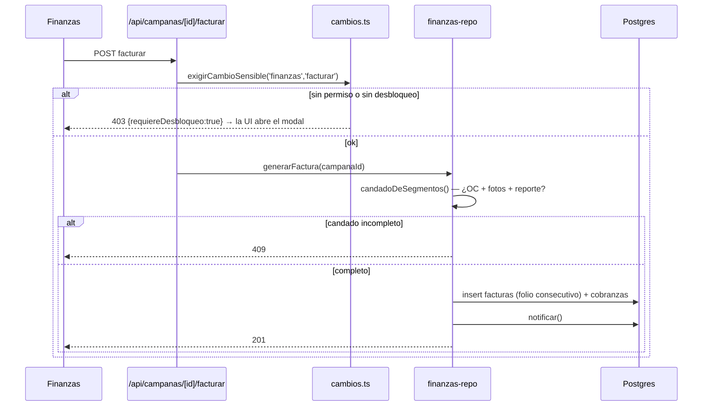

# Finanzas: facturación y cobranza

> [!note] Los reportes de rentabilidad son otra nota, y otra base de cálculo
> `GET /api/reportes/rentabilidad` exige el mismo permiso que esta nota
> (`finanzas`, `ver`) pero **no lee ni facturas ni pagos de renta**: su base es
> **devengado** —ingreso de `reservas`, costo de `contratos_arrendamiento`—,
> que es lo que ya calcula el dashboard, así que sus números coinciden con lo
> que la aplicación enseña y no hay dos verdades que explicar. Ver
> [[reportes-rentabilidad]].

> [!danger] Dinero irreversible
> `POST /api/campanas/[id]/facturar` y `POST /api/cobranzas/[id]/pagar` son
> `SENSIBLE` (permiso + desbloqueo). Emitir una factura consume folio fiscal.
> Ver [[zonas-de-riesgo]].

> [!warning] Hasta el 2026-08-28 el «+ desbloqueo» no pedía nada en una instancia nueva
> `exigirCambioSensible()` tiene dos mitades, y la segunda —comprobar que quien
> está al teclado es esa persona— cuelga de `tenants.exigir_reautenticacion`
> (`exigeReautenticacion`, `cambios.ts:64-71`, que consulta `exigirDesbloqueo` en `:275-278`; `exigirCambioSensible` está en `:316`). Esa columna nació con `default false`
> (`20260804_reautenticacion_individual.sql:34`) y **nada en las semillas ni en
> el aprovisionamiento la tocaba**: cada instancia nueva arrancaba con el candado
> abierto, incluidas las **tres rutas de dinero** —`facturar`, `cobranzas/pagar`
> y `pagos-renta/pagar`— y otras cinco de contratos y arrendadores.
>
> **El permiso del rol sí aplicaba**: no es que pudiera facturar cualquiera. Lo
> que faltaba era la reautenticación.
>
> `20260828_reautenticacion_por_defecto.sql` cambió **el DEFAULT, no las filas**:
> toda organización que nazca de aquí en adelante pide la contraseña; las que ya
> existen se quedan como estén, porque encenderlo en una base que ya opera es una
> corrección de datos con su rollback, no una migración de esquema.
>
> Sigue siendo un interruptor (ADR 0009): lo que cambió es la **polaridad** — se
> apaga a propósito en vez de encenderse a propósito. La fricción es menor de lo
> que suena: el desbloqueo dura 15 minutos (`DESBLOQUEO_MINUTOS`, `cambios.ts:58`), así que facturar
> diez campañas seguidas pide la contraseña una vez.
>
> **2026-09-21 · y ya no tiene que ser la contraseña propia** (ADR 0036, enmienda
> al 0009, commit `a2355019`): el candado vuelve a aceptar también una
> **contraseña compartida** que asigna el Dueño
> (`20260921_restaura_contrasena_compartida_cambios.sql`). Abre el candado
> general —el de facturar y cobrar incluido—, pero no
> `exigirReautenticacionSiempre()`, que exige la propia
> (`sesiones.desbloqueo_es_propio`). Detalle en [[autenticacion-y-sesion]].

## El candado de facturación

No se puede facturar una campaña hasta que se cumplan tres condiciones
(`campanas`, `db/schema.sql:393-396`):

| Columna | Qué prueba | Quién la enciende |
|---|---|---|
| `oc_recibida` | El cliente mandó su orden de compra | Imprenta/Comercial (`ordenes_compra`) |
| `fotos_comprobatorias` | Hay evidencia de que se instaló | Cierre de OT ([[operaciones-y-ot]]) |
| `reporte_publicacion` | Se generó el reporte | Cierre de OT |

`candadoDeSegmentos()` (`lib/data/derive.ts`) evalúa el candado **por segmento**:
el hallazgo A-2 exigía OC + evidencia por segmento, y una segunda factura sobre
lo mismo responde **409**.

## Cobro en parcialidades

`20260728_cobro_parcialidades.sql` + `lib/finanzas-calculo.ts` (`repartirCuotas`,
`opcionesParcialidad`). Reglas verificadas por
`apps/web/lib/test/flujo-critico.e2e.test.ts`:

- las cuotas **suman exacto** al total (sin centavos perdidos);
- un plan que no cabe en la vigencia se rechaza;
- el abono está acotado al saldo;
- la liquidación cierra la cobranza.

## Fiscal

`facturas` guarda un **snapshot** de los datos fiscales al emitir (`rfc`,
`razon_social`, `uso_cfdi`, `serie`, `folio_fiscal`): si el cliente cambia sus
datos después, la factura emitida no cambia.

> [!note] 2026-09-18 · la razón social que EMITE (`8c6002e7`)
> `facturas.entidad_emisora_id` dice cuál de **mis** razones sociales emite el
> comprobante. `POST /api/campanas/[id]/facturar` la recibe como
> `entidadEmisoraId` (`finanzas-controller.ts:120`) y solo viaja al `insert`
> (`finanzas-repo.ts:209-211`): **no toca ningún importe**. Ausente o `null` =
> «sin asignar», y el servidor no la adivina; la preselección por roles es solo
> de la pantalla. El esquema de facturar ganó `.strict()`
> (`finanzas-controller.ts:125-131`): un `monto` colado en el cuerpo ya no se
> ignora en silencio, es un 400. Ojo al nombre: `razon_social` de la factura es
> la del **cliente**; la mía es `entidad_emisora_id` (`finanzas-repo.ts:30-33`).
> Ver [[entidades-fiscales]] y [[multi-entidad-en-uso]].

`lib/server/config-fiscal.ts` resuelve el IVA y la razón social comercial por
tenant. El IVA por cliente vive en `clientes.iva_pct` (default 16).

> [!warning] Herencia de un despliegue en Perú
> Los defaults del esquema dicen `PEN` e `IGV 18%` (`db/schema.sql:110,390,543`),
> pero la operación real es en México (`MXN`, IVA 16%) y hay migraciones que lo
> corrigen (`20260724_a3_moneda_default_mxn.sql`,
> `20260724_moneda_por_tenant.sql`). Los nombres de columna `igv` se quedaron.

## Cada pago con su fecha, y Finanzas por periodo (06/10, ADR 0046)

> [!important] Hasta el 06/10 el sistema no sabía CUÁNDO entraba un pago
> `cobranzas.monto_pagado` es un acumulado: cada pago le sumaba su importe y
> la fecha se perdía. Desde `20261008_cobranza_abonos.sql` cada pago deja un
> renglón en **`cobranza_abonos`** —importe, día, quién— y el invariante
> `monto_pagado = sum(abonos)` lo sostiene `registrarPagoCobranza`
> (`finanzas-repo.ts:290`) escribiendo las dos en **una transacción con la
> cobranza bloqueada** (`for update`).

Lo que trajo, y lo que cerró de paso:

- **El pago admite `fecha`** (la de la transferencia), por omisión hoy en la
  zona de la base, nunca futura. `usuario_id` sale de la sesión.
- **El doble clic ya no cobra dos veces**: antes dos pagos simultáneos leían
  el mismo acumulado. Y pagar lo ya pagado es un **409**, no un «pago de $0».
- **Lo cobrado antes** se rescató con `origen = 'historico'`, un renglón por
  cobranza fechado con el último pago de la bitácora; sin rastro, sin fecha en
  la base, y el cálculo lo **fecha con su factura** marcándolo aproximado (no
  «antes de todo»: eso dejaba el año con saldo inicial negativo).
- **`GET /api/finanzas/resumen`** (`finanzas.ver`) sirve el tablero y el
  estado de cuenta; las cuentas son puras en `lib/finanzas-periodo.ts`, con
  las definiciones escritas en su cabecera. El vencido se mide al **corte**:
  fin del periodo, o hoy si no ha terminado.
- En pantalla: **Resumen del periodo** arriba de Finanzas (mes, mes pasado,
  trimestre, trimestre pasado, año, rango) y **Estado de cuenta** (este mes /
  mes pasado, empresa o un cliente, con CSV) después de Cobranza.
- **«Vencida» en una cuota pagada** era la columna «Vence», que miraba solo la
  fecha: ahora el estado manda (`components/demo/finanzas/vencimiento-cuota.ts`).

Cobertura: `lib/finanzas-periodo.test.ts` (21, con cinco mutantes muertos),
`vencimiento-cuota.test.ts`, `estado-cuenta-csv.test.ts` y la e2e
`lib/test/finanzas-periodos.e2e.test.ts` (RLS, invariante, doble clic, rescate).

## El comprobante de cada pago (19/10, COB-COMP)

Pedido del dueño el 19/10: en Cobranza no había dónde subir el recibo o la
transferencia del cliente, y en los pagos de renta sí
(`pagos_renta.comprobante_url`). Desde `20261019_cobranza_abono_comprobante.sql`
cada **abono** lleva su `comprobante_url` — en el abono y no en la cobranza,
porque una cobranza se paga en varios abonos y el segundo recibo pisaría al
primero.

- **Al registrar el pago** (`POST /api/cobranzas/:id/pagar`) el cuerpo admite
  `comprobanteUrl`: PDF, JPG, PNG o WEBP de hasta 5 MB
  (`LIMITES.adjuntoPago`, los mismos que en renta). Se valida en el controller
  **antes** de tocar la base, y se escribe en el **mismo `insert`** del abono:
  un archivo inválido es un 422 y no deja el pago a medias.
- **Después**: `PATCH /api/cobranzas/:id/abonos/:abonoId` con
  `{ comprobanteUrl }` (`finanzas.crear`) adjunta o reemplaza. El cuerpo es
  `.strict()`: no puede tocar importe ni fecha. No lleva candado, igual que los
  adjuntos de renta: no mueve dinero. Queda en la bitácora como «Adjuntó
  comprobante de pago». No hay «borrar»: lo equivocado se reemplaza.
- **La lista** `GET /api/cobranzas/:id/abonos` (`finanzas.ver`) dice si hay
  comprobante pero **no trae el archivo**; el archivo se sirve aparte por
  `GET …/abonos/:abonoId/comprobante`, con su `Content-Type` y `no-store`.
- Las tres consultas (`listarAbonosCobranza`, `adjuntarComprobanteAbono`,
  `obtenerComprobanteAbono` en `finanzas-repo.ts`) van por `q` con tenant **y**
  filtran `tenant_id` y la cobranza: un abono solo se alcanza por la cobranza a
  la que pertenece.
- En pantalla: el campo **«Comprobante de pago (opcional)»** en «Registrar
  pago», y **«Pagos y comprobantes»** en cada cuota con algo pagado (también
  pagada), con «Adjuntar» / «Reemplazar» por abono
  (`components/demo/finanzas/ComprobantePago.tsx`).

Cobertura: `lib/server/finanzas-controller.comprobante.test.ts` (validación;
el repo no se llama con un archivo inválido) y la e2e
`lib/test/comprobante-cobranza.e2e.test.ts` (el archivo en su abono, sin pago a
medias, la lista sin el archivo, subirlo después sin tocar el saldo, abono de
otra cobranza, otra organización y un VENDEDOR sin permiso).

## Cobranza y recordatorios

`cobranzas` lleva `plazo_dias` (default 90), `fecha_vencimiento`,
`recordatorio_en` y `recordatorios_enviados` — cadencia + idempotencia. Los
plazos válidos salen de `config_negocio.plazos_cobranza` (`{60,90,120}` por
omisión de la columna).

> [!warning] Hasta el 2026-08-26 esa frase describía una intención, no el código
> La columna existía, la pantalla la editaba y se guardaba bien — y después
> `finanzas-controller.ts` la tiraba con un `[60, 90, 120].includes(v)` a fuego.
> Una organización que configurara 45 días veía «Plazo inválido (60, 90 o 120
> días)». Lo encontró la auditoría externa del 26/08 (CFG-01).
>
> Ahora la lista se lee **del tenant** con `plazosCobranzaDelTenant()`
> (`config-repo.ts:112`), y con dos cautelas que conviene no deshacer:
>
> - **Lista vacía → respaldo `{60,90,120}`.** Es alcanzable: Administración
>   borra plazos uno a uno sin mínimo (`administracion/page.tsx:984`) y
>   `PATCH /api/config` acepta el arreglo vacío. Tomarla al pie de la letra
>   dejaría a esa organización **sin poder emitir ninguna factura** — peor que
>   el fallo que se corrigió, y sobre dinero.
> - **Solo valida lo que se ESCRIBE.** Una factura ya emitida a 45 días sigue
>   viva, se sigue leyendo y se sigue cobrando aunque se retire el 45 de la
>   configuración. Un plazo retirado no congela dinero en vuelo.
>
> Queda suelto: `plazoDias` sigue tipado `60 | 90 | 120` en `finanzas-repo.ts`,
> `lib/data/types.ts` y `estado-api.ts`. Es solo el tipo —la columna es
> `integer` y el valor llega validado—, con un cast comentado en los dos puntos
> de paso.

## La pantalla, rediseñada (26/10) — solo presentación

Rediseño de la pantalla de Finanzas con el lenguaje del Dashboard
([[dashboard-inicio]]). **No cambió ninguna cifra, ningún cálculo, permiso ni
candado**: `GenerarFacturaDialog` y `PagoModal` no se tocaron por dentro.

- **Resumen del periodo** (`components/demo/finanzas/TableroPeriodo.tsx`):
  cuatro `KPICard` — *Por cobrar al cierre*, *Vencido* (en pesos, con «N
  facturas al dd/mm» debajo), *Facturado* y *Cobrado*—; la renta baja a una
  franja secundaria debajo. Antes eran seis tarjetas iguales. En un teléfono el
  selector de periodo es un `<select>` con las **mismas** opciones
  (`OPCIONES_PERIODO`) y el mismo `setTipo`; a 390 px los seis botones
  sacaban el chevrón de la pantalla. Las fechas del rango van en el contenido
  en móvil.
- **Orden**: Resumen → Listas para facturar (solo si hay alguna; vacía baja al
  final en una línea) → **Cobranza** → Facturas → Estado de cuenta → renta.
  Cobranza va antes que Facturas porque es lo que pide acción.
- **Cobranza**: chips de conteo del Dashboard (`ChipConteo.tsx`) con la
  palabra «Cuotas» delante — cuenta **cuotas**, no facturas, y el resumen del
  periodo cuenta facturas. Folio en una línea; «Emite: …» siempre visible bajo
  el folio (el comentario de `FilaCuota` lo exige también en cuota única);
  folio fiscal y RFC solo desde `xl`; Cliente desde `md` (debajo del folio en
  móvil); Plazo desde `lg`. Los días a vencer son la pastilla del Dashboard con
  el **mismo** texto de `etiquetaVencimiento`. «Registrar pago» pasa del verde
  con hex al azul del sistema; mismos manejadores y mismo `disabled`.
- **Facturas**: cabecera común, folio y monto sin partirse, `StatusBadge`
  (Emitida azul, Pagada verde, Anulada neutra y tachada), folio fiscal y
  emisora desde `lg`, diez filas y «Ver todas (N)», esqueleto al cargar.
- **Estado de cuenta**: las cinco cifras como una ecuación en la franja
  secundaria; en móvil el mes es un `<select>` con los mismos dos valores.

Lo que **no** se hizo, y por qué: un total «por cobrar» en la tarjeta de
Cobranza (sería una suma nueva hecha en el navegador; ya está en el KPI del
resumen, que viene del servidor) y tocar `PagosRentaCard`/`CompromisoRentaCard`
(son de [[arrendadores-y-contratos]]).

## Relacionadas
[[flujo-facturacion-y-cobranza]] · [[comercial-propuestas-campanas]] ·
[[operaciones-y-ot]] · [[esquema]] · [[zonas-de-riesgo]] · [[MOC-Proyecto]]
