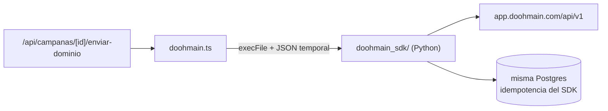

# Integraciones externas

**Patrón común: toda integración está gateada por sus variables de entorno.** Si
no están, la función `*Habilitado()` devuelve `false` y el sistema opera sin ella
sin romperse.

| Integración | Gate | Estado hoy |
|---|---|---|
| DigitalOcean Spaces (S3) | `storageHabilitado()` — las 4 `DO_SPACES_*` | Configurable |
| Resend (correo) | `emailHabilitado()` — `RESEND_API_KEY` + `EMAIL_FROM` | **Apagado en producción** |
| Google OIDC | `googleHabilitado()` — `GOOGLE_OAUTH` + `GOOGLE_CLIENT_ID`/`SECRET` | **Apagado**, migración ya aplicada |
| DOOHmain | `DOOHMAIN_PUBLISH_ENABLED=1` | Detrás de flag |
| Space Eye | `spaceEyeHabilitado()` — URL + credenciales | Configurable |
| AdMobilize, CMS, PAC CFDI | `lib/server/integraciones.ts` | **Modo demo simulado** |
| Buscador de calles (Comercial negociación) | `GOOGLE_MAPS_SERVIDOR_KEY` — con ella Google, sin ella OpenStreetMap | **Sin clave en la flota** (29/10): Nominatim |

## Buscador de calles y enlaces de Google Maps (UBIC-01, 29/10)

Decisión del dueño del 2026-10-29 (ADR 0041, ya **Aceptada** en esta parte): en
Comercial negociación la ubicación se pone **por coordenadas o por calle**.
Todo corre en el **servidor**, detrás de `GET /api/geo/buscar` con el permiso
`captacion:ver`; el navegador no habla con Google ni con OpenStreetMap, así que
**la CSP no cambia** y la clave **no llega nunca al navegador**.

| Lo que se pega | Quién lo resuelve | Sale a la red |
|---|---|---|
| Coordenadas (decimales, grados/minutos/segundos) | `lib/interpretar-ubicacion.ts`, puro, en el navegador **y** otra vez en el servidor | No |
| Enlace largo de Google Maps (`/@lat,lng`, `/place/…`, `!3d…!4d…`, `?q=`, `?query=`, `?ll=`) | El mismo módulo: las coordenadas van en la URL | No |
| Enlace corto (`maps.app.goo.gl/…`, `goo.gl/maps/…`) | `lib/server/geo-enlace.ts` | Sí: solo a esos dos hosts, por https |
| Una dirección | `lib/server/geo-buscar.ts` | Sí: Google con clave, Nominatim sin ella |

**El proveedor se elige en cada búsqueda** leyendo `GOOGLE_MAPS_SERVIDOR_KEY` del
`app.env` de la instancia (vacía o con espacios = sin clave). Es tiempo de
ejecución, como `GOOGLE_OAUTH`: la misma imagen sirve con clave y sin ella. Es una
clave **de servidor** (en Google Cloud: restringida por la IP del servidor y solo a
la **Geocoding API**), no la «de navegador» restringida por dominio que el ADR 0041
describe para el día que haya mapas de Google en pantalla. **Nadie la ha probado con
una clave real**: las pruebas simulan las respuestas de Google.

- Con Google **no** se aplica la espera de 1/s (es la política de Nominatim); el
  gasto lo acotan el tope de 30 búsquedas por persona cada 10 min, la memoria de
  24 h (por proveedor) y el tope de gasto que el owner ponga en su cuenta.
- Un `REQUEST_DENIED` u `OVER_QUERY_LIMIT` es un **502 con frase** que dice «revisa
  la clave»; **no** se cae a OpenStreetMap a escondidas, y el mensaje de Google no
  se reenvía (puede traer la clave).
- **Seguir un enlace corto es SSRF en potencia**, y por eso: solo se pide un enlace
  corto de Google por https (lista cerrada de hosts, sin usuario ni puerto); las
  redirecciones se siguen a mano (`redirect: 'manual'`) y cada salto se revisa; un
  destino de Google Maps se **lee** sin pedirlo; cualquier otro destino se corta sin
  pedirlo; máximo 5 saltos y 6 s por salto; no se lee el cuerpo. Cada enlace corto
  cuenta para el tope por persona.
- **Términos de Google:** de sus resultados solo se guarda sin límite el `place_id`
  (va a `prospectos.ubicacion_place_id` cuando la persona elige un candidato de
  Google y no mueve el pin). Las coordenadas que se guardan son las que la persona
  confirma en el mapa. **Queda por verificar** si mostrar un candidato de Google
  sobre el mapa MapLibre (no de Google) cumple sus términos: el ADR lo deja escrito
  como riesgo abierto.

## DOOHmain — publicación en pantallas

`lib/server/doohmain.ts` (**403 líneas** el 31/08, y siguen siendo 403 el 05/10; eran 313 el 07/08). Al aprobar la publicación de una campaña,
publica cada creativo validado en cada pantalla **invocando un SDK de Python por
subproceso** (`execFile`), con el mismo contrato JSON del CLI.



> [!danger] Ejecución de subproceso
> `execFile` con rutas que vienen de variables de entorno (`DOOHMAIN_PY`,
> `DOOHMAIN_SDK_DIR`) y un mapa JSON (`DOOHMAIN_SCREEN_MAP`). No es entrada de
> usuario, pero cualquier cambio aquí es zona ROJA. La idempotencia la resuelve
> el SDK contra sus propias tablas.

> [!warning] v0.12.3 (SIN PUBLICAR, 22/10) · el reemplazo de un creativo publicado
> El dueño vio en DOOHmain «las 3 imágenes»: al reemplazar, el arte viejo **sigue en la
> lista** de DOOHmain porque su API no deja quitar elementos; lo que se hace es finalizar
> su campaña (fechas en el pasado, cuotas en 0) para que no se reproduzca. Ahora la
> pantalla lo dice. Y dos defectos de la ruta `PUT/DELETE /api/creatividades/[id]`:
> - si el creativo estaba publicado y DOOHmain **no confirmaba** el retiro, se reemplazaba
>   igual y decía «Arte reemplazado»: el viejo podía seguir sonando. Ahora es 502 y no se
>   toca nada (`estaPublicadoEnDoohmain`); uno nunca publicado se reemplaza sin preguntar;
> - se retiraba en DOOHmain **antes** de comprobar que el creativo era de la organización:
>   con un id ajeno se finalizaba su campaña y luego se contestaba 404. Ahora
>   `esCreativoPropio` va primero.

> [!important] 2026-10-22, noche · el horario INDIVIDUAL de la campaña, y el id que se usa en Inventario
> - **Horario individual** (pedido del dueño, forma «horario + días» aprobada):
>   `campanas.doohmain_hora_inicio/fin/dias` (`20261022_campana_horario_doohmain.sql`),
>   se fija en la vista previa de la campaña con `PATCH …/horario-doohmain`. **Gana**
>   sobre la programada y la contratada (`franjaQueViaja`); sus días viajan como
>   `days` de `create_spot` (`--dias` del SDK). Probado contra un DOOHmain falso.
> - **23/10 · solo para campañas SIN franja** (regla del dueño: «si la campaña ya
>   tiene franja de horario no debe de tener la opción de añadir otra»). Con franja
>   programada, o contratada en alguna reserva no cancelada (`franjaDeCampana` en
>   `lib/server/franja-de-campana.ts`, misma precedencia que `leerPlan()`), el PATCH
>   con horario es **409** que nombra la franja, y la vista previa trae
>   `franjaCampana` para que el cuadro diga cuál viaja en vez de ofrecer otro.
>   Quitar (`horario: null`) se deja siempre: una campaña que ya tenía los dos de
>   antes —donde el individual sigue ganando— puede quedarse solo con la franja.
> - **El id en Inventario:** `rowToSitio` añade `doohmainEfectiva` y `doohmainOrigen`
>   (`pantallaDoohmainDe`, mismo orden que publica: ficha → `DOOHMAIN_SCREEN_MAP` →
>   `DOOHMAIN_DEFAULT_SCREEN`). La tabla y la ficha lo enseñan; al editar, el campo
>   vacío dice cuál se usa hoy. Era lo que el dueño veía «vacío y ya estaba».

> [!tip] 2026-10-22, tarde · y se VE antes de mandarlo
> Pedido del dueño: en la campaña, antes de subirla, ver las franjas y las
> repeticiones. `ProgramacionDoohmain.tsx` (dentro de Validación de publicación)
> lee `GET /api/campanas/[id]/programacion-doohmain`, que sale de `leerPlan()`: la
> MISMA consulta que `publicarCampanaEnDoohmain`, para que la vista previa no
> pueda enseñar otra cosa (lo fija una e2e de `creativo-por-pantalla`). Sin
> pauta se lee «Las que quepan», no un cero. Y el aviso de la franja
> (`AVISO_FRANJA_NO_VIAJA_AL_CMS`, `lib/rejilla.ts`) se reescribió: decía que la
> franja no se envía al CMS, y desde hoy a DOOHmain sí; queda manual en otro CMS
> y en un anuncio ya publicado.

> [!important] 2026-10-22 · a DOOHmain le llega ya TODO lo que su API recibe
> Pedido del dueño: mandar las reproducciones dentro de la franja si la campaña
> tiene una, o el total del periodo, y los datos del cliente — **la franja SOLO si
> existe; si no, lo de siempre**. Hasta hoy solo viajaban fechas, nombre del
> cliente y `cant_day`. La regla está en `lib/doohmain-programacion.ts`, con prueba:
> - `cant_day` = spots por día (como antes; null sin pauta) · `cant_total` = spots
>   por día × días de la campaña (solo con pauta) · `auto_cant=1` solo con franja,
>   para que DOOHmain reparta las del día dentro del horario;
> - el horario va en el spot (`start_time`/`end_time`) y sale de la franja
>   **programada** de la campaña (PROG-01) o, si no tiene, la **contratada** de esa
>   pantalla (`reservas.franja_id`). Sin ninguna, no se manda;
> - el cliente: `name`, `cuit` (RFC), `real_name` (razón social), `address` (del
>   contacto, si la tiene) y `client_type` (Directo / Agencia: no guardamos giro).
>   Se manda al crear y, con `update_client`, al re-publicar;
> - no se mandan `cant_hour` ni `days` (no hay pauta por hora ni días en las franjas).
> **Lo que contradice esto:** los comentarios de columna de `reservas.franja_id` y
> `campanas.franja_programada_id` dicen que la franja «no viaja al CMS». Eran ciertos
> hasta hoy y viven en migraciones ya aplicadas, que no se editan. **Y un límite:** un
> arte que YA estaba publicado no se vuelve a mandar (`create_spot` no deduplica), así
> que su horario no cambia al re-publicar; sí cambian las cantidades y el cliente.
> Probado con el SDK contra una API y una base falsas (con y sin franja: sin ella, las
> peticiones son idénticas a las de antes) y en `creativo-por-pantalla.e2e.test.ts`.

> [!note] 2026-10-22 · el recordatorio de no tener la pantalla abierta en el sitio de DOOHmain
> Pedido del dueño: en Campañas, al enviar al dominio y subir el creativo, recordar
> que no se esté en la pantalla dentro del sitio de DOOHmain para permitir el
> proceso. `ValidacionPanel.tsx` lo enseña en ámbar debajo de sus botones y dentro
> de los dos diálogos que publican («Aprobar y publicar» y «Volver a publicar»).
> El texto y la regla de cuándo se ve —una campaña DOOH o híbrida y alguien con
> `comercial.crear`, en cualquier estado— están en `lib/doohmain-aviso.ts`, con
> prueba. Es solo un aviso: la aplicación no puede saber si alguien tiene la
> pantalla abierta en DOOHmain.

> [!danger] 2026-10-13 · Hasta `20261013_doohmain_seguimiento_unicas.sql`, publicar FALLABA en toda base levantada desde el repo
> `20260805_objetos_solo_en_prod.sql` creaba las tres tablas del SDK
> (`doohmain_remote_campaigns`, `doohmain_remote_lists`, `media_uploads`) sin
> identidad en `id` y sin las únicas; `20260901_doohmain_tracking.sql` las
> define bien pero con `if not exists`, y no hacía nada. El SDK
> (`doohmain_sdk/db.py`) usa `ON CONFLICT` y reventaba **después** de
> `create_campaign`: campaña vacía en DOOHmain, ni arte ni spot. Probado de
> punta a punta contra un DOOHmain simulado: [[07-Agentes/diario/2026-10-13]].
>
> **El resultado ya se ve.** `ValidacionPanel.tsx` descartaba el campo
> `doohmain` de `POST /api/campanas/:id/validar`; ahora lo lee
> `lib/doohmain-resultado.ts` y la ficha lista cada pantalla con su pantalla de
> DOOHmain y «Publicada» / «Ya estaba publicada» / el error. No se guarda: al
> recargar queda el renglón de Actividad, que nombra las que fallaron.
>
> **Sigue abierto, y es de dinero (ROJO):** aprobar pasa la campaña a
> `LISTA_FACTURAR` y enciende `reporte_publicacion`
> (`campanas-repo.ts:1306`) **antes** de publicar y sin mirar el resultado.
>
> **Reintento (13/10, pedido del dueño):** con la publicación aprobada, la ficha
> ofrece «Volver a publicar en DOOHmain» → `POST /api/campanas/:id/reintentar-publicacion`.
> Solo publica: no toca estado, aprobación ni candado (`campanaParaReintentarPublicacion`
> no escribe nada), exige la misma asignación por pantalla que aprobar, y lo ya
> publicado sale como «Ya estaba publicada».

> [!success] 2026-10-13 · La pantalla de DOOHmain se captura en la ficha (rama `feat/doohmain-pantalla-por-sitio`)
> `sitios.doohmain_pantalla` (`20261013_sitios_pantalla_doohmain.sql`) es el nombre de la
> pantalla tal como lo conoce DOOHmain. Al publicar el orden es **ficha →
> `DOOHMAIN_SCREEN_MAP` → `DOOHMAIN_DEFAULT_SCREEN`**: una instancia que ya usa el mapa
> no cambia. La ficha ofrece las pantallas de la cuenta
> (`GET /api/integraciones/doohmain/pantallas` → `doohmain_sdk ping`, `inventario:ver`);
> sin respuesta, se escribe a mano.
>
> **Y el CMS de la ficha se respeta.** Una pantalla con `cms` distinto de
> `DOOHMAIN` ya no se manda: sale `estado: 'otro_cms'` («Se programa en su CMS») y
> no cuenta como fallo. Antes una Broadsign se publicaba en DOOHmain por el mapa o
> por la pantalla por omisión — pasó en la verificación del 13/10 con `CAT-D02`.
> Sin CMS en la ficha se publica como hasta hoy. Prueba del orden:
> `lib/server/doohmain.pantalla.test.ts`.

`playlogs-repo.ts` guarda la respuesta **cruda** de la API a propósito: *«aún no
hemos visto una respuesta con datos, así que no se interpreta nada todavía»*.

## Space Eye — verificación por cámara

> [!success] 2026-10-01 · **Módulo Space Eyes en el menú** (rama `feat/space-eyes-con-mejoras`)
> Grupo propio **Space Eyes** entre Inventario y Comercial (lo ven `MANDO` y
> `VENTA`, con `inventario.ver`; pedir foto o subirla, `inventario.crear`):
> listado de la flota, ficha del equipo, historial, captura a demanda y alta de
> equipos. Habla con Space Eye **con una llave de servicio** (`SPACE_EYE_KEY`) y
> ya no con usuario y contraseña: con la cuenta admin cualquier instancia veía
> la flota entera, y la RLS de aquí no puede proteger datos que no están en esta
> base. Las fotos se sirven por `/api/space-eyes/foto` (sin contenido mixto,
> sin SSRF). `SPACE_EYE_*` ya está en `infra/env/app.env.example` (el que recibe el contenedor), que era
> el hueco de abajo.
>
> **Fallas y creativos en la ficha** (`PantallaYCreativos.tsx`):
> `GET /api/space-eyes/:id/fallas` y `/creativos` leen de Space Eye
> `/api/devices/:id/pantalla` y `/creativos`, que desde el 01/10 aceptan llaves
> **solo en lectura** y comprueban el dueño (404 por un equipo ajeno, que aquí es
> `disponible: false`). Requieren Space Eye con esas rutas abiertas (V2, `:4200`).
>
> **El panel entero dentro del módulo** (01/10): las ocho pantallas del panel de
> Space Eye viven ya en `/space-eyes/…` (Equipos, `galeria`, `graficas`, `texto`,
> `programacion`, `campanas`, `verificacion`, `fallas`), y la ficha del equipo
> tiene pestañas Fotos · En vivo (WHEP, `lib/space-eyes-whep.ts`) · Pantalla y
> fallas · Creativos · Equipo. Todas hablan por la puerta
> `/api/space-eyes/se/[...ruta]` (lista cerrada de rutas; GET con
> `inventario.ver`, escribir con `inventario.crear`). Probado en local con la base
> real de los equipos de :4000 más el de pruebas de :4100 (7 equipos, g500).

> [!important] 2026-10-06 · revisión con correcciones (rama `fix/space-eyes-revision`)
> Pedida por el dueño sobre `feat/space-eyes-con-mejoras` en `8afa2ed8`. Lo que
> cambió, cada cosa con su prueba en rojo primero:
>
> - **Las órdenes a un equipo pasan por una lista** (`ORDENES` en
>   `app/api/space-eyes/se/[...ruta]/route.ts`): TAKE_PHOTO, START/STOP_STREAM,
>   REBOOT_APP, UPDATE_APP y REBOOT_DEVICE. Antes el `command_type` lo elegía el
>   navegador y pasaba cualquiera. Reiniciar (app o equipo) y actualizar quedan
>   en la **bitácora de acciones** con quién y qué equipo, solo si Space Eye la
>   aceptó. `space-eyes-ordenes.test.ts`.
> - **Los instaladores se bajan por esta aplicación**
>   (`/api/space-eyes/descarga/<apk|agente-pc|agente-pi|ffmpeg>`, lista cerrada)
>   y la ficha **enseña el SHA-256**. El `href` iba directo a Space Eye por HTTP:
>   en una instancia HTTPS Chrome bloquea esa descarga, y en la wifi del sitio
>   el binario se podía cambiar. `space-eyes-descargas.test.ts`.
> - **«Inventario» dice que abre Space Eyes** en la matriz (`lib/modulos.ts`,
>   área `space-eyes`), con un guard que cubre todo el grupo `ojos` del menú.
>   `space-eyes-permisos.test.ts`.
> - **`/api/space-eyes/foto` rechaza `//`**, que su comentario prometía.
> - El comentario de `pedirCaptura` que decía «lo ÚNICO que esta integración
>   escribe» se corrigió, y el ADR pasó de **0041 a 0045** (chocaba con Google Maps).
>
> [!important] 2026-10-19 · **el encuadre que SE QUEDA, solo del Dueño** (rama `fix/space-eyes-fotos-rapidas` de José, `v0.11.10`)
> En g500 varias personas movieron el zoom desde el visor y dejaron torcido el
> encuadre de tres pantallas; el catálogo de creativos que cada equipo aprende
> vale para UN encuadre, así que se tira entero al cambiarlo.
>
> - **La regla:** `puedeEncuadrar()` en `lib/roles.ts` (solo `DUENO`), con
>   pruebas. La puerta `app/api/space-eyes/se/[...ruta]/route.ts` contesta
>   **403** a quien no es Dueño en `POST/PUT/DELETE` de
>   `devices/:id/(camera|stream-rotation|pantalla)` y lo deja en la bitácora.
> - **El visor sigue siendo de quien opera:** `camera-control` de quien no
>   encuadra se reenvía con `guardar: false` (exposición y balance no se quedan
>   en el equipo), y la foto sale con `encuadre_temporal`, sin tocar el del sitio.
> - **El candado real es éste, no el de Space Eye:** Space Eye exige
>   `requireRole('admin')`, pero esta puerta le habla con la llave de la
>   instancia, que es admin. Lo que necesita la pila nueva de Space Eye
>   (`update-eyes.sh`, migraciones 026 y 027) es entender `guardar: false`.
> - **OPERACIONES no tiene `inventario.crear`** (solo `ver`, desde
>   `20260804_modulo_inventario.sql`): hoy no abre la vista en vivo. Pendiente
>   aparte, pide migración.
>
> Despliegue y comprobaciones: `docs/evidencias/25-despliegue-space-eyes-g500-20261019.txt`.

> **Lo que NO se pudo arreglar desde aquí:** que Space Eye se sirva por HTTPS
> (servidor), y si la marca `escritura` de la llave alcanza solo la captura
> —como afirma `infra/env/app.env.example`— o también las órdenes. Si fuera
> lo primero, reiniciar y el vivo darían 403 desde Space Eye. Pregunta para
> quien lleva Space Eye.

`lib/server/space-eye.ts`. Cada espectacular tiene un teléfono Android que
captura fotos y las verifica contra la creatividad con IA. El enlace
pantalla↔cámara es **por código**: `sitios.codigo_proveedor == device.billboard_code`.
Credenciales **solo por env, nunca al cliente**.

> [!danger] 2026-09-17 · `SPACE_EYE_*` no está en NINGUNA plantilla
> Se lee en `space-eye.ts:17-19` y **no se declara en
> `infra/env/app.env.example`**. Hoy **no hay ningún camino** por el que esas
> variables lleguen a una instancia aprovisionada.
>
> **El modo de fallo es silencioso**, que es lo que lo hace caro:
> `spaceEyeHabilitado()` devuelve `no_configurado` sin error ni aviso
> (`space-eye.ts:116`). Una instancia nueva nace con Space Eye apagado y nadie
> se entera hasta que un cliente pregunta por sus cámaras.
>
> **Es la misma familia que costó dos correcciones el mismo día** (PR #89):
> `provision-instancia.sh` no escribía ninguna clave de respaldo, y al
> arreglarlo `SPACES_REGION` **seguía perdiéndose** porque
> `reescribir_env_sourceado` parte de la plantilla y la plantilla no la
> declaraba. **La plantilla es el eslabón que se olvida.**
>
> Aplica igual a `ADMOBILIZE_API_KEY`, `CMS_API_TOKEN` y `CFDI_PAC_KEY`, que el
> traspaso del 15/09 ya había señalado.
>
> **2026-10-05 · sigue igual.** Ninguna de las tres plantillas de `infra/env/`
> (`app.env.example`, `instancia.env.example`, `ejecutor.env.example`) declara
> `SPACE_EYE_*`, `ADMOBILIZE_API_KEY` ni `CFDI_PAC_KEY` — medido con `grep`.
>
> **Eso es `main`.** En la rama de Space Eyes `app.env.example` **sí** declara
> `SPACE_EYE_BASE_URL`, `SPACE_EYE_KEY` y el testigo (`8444721c`, 01/10): el
> hueco se cierra cuando esa rama aterrice.

> [!success] 2026-09-17 · el PADRE NO lleva la integración — medido, no supuesto
> Se levantó como «divergencia del E4.1» del plan de Space Eye. **No existe.**
> Leído el entorno real del PADRE (`/etc/space-os/padre.env`, que es el
> `EnvironmentFile` de `spaces-web.service:77`):
>
> ```
> SPACE_EYE_BASE_URL     VACIA
> SPACE_EYE_USER         VACIA
> SPACE_EYE_PASS         VACIA
> ```
>
> Coincide con `docs/Runbook_Padre_Droplet_Nuevo.md:405` (era `:370` el 17/09), que lista `SPACE_EYE_*`
> como **«No. Son de operación, y el PADRE es plano de control»**.
>
> **Lo que sí está encendido con credenciales reales es el entorno de
> desarrollo**: `apps/web/.env.local`, que está en `.gitignore:15` y nunca se ha
> versionado. Eso es lo correcto, y era el origen de la confusión: el «aquí» de
> aquella nota era la máquina de desarrollo, no el plano de control.
>
> **Queda un cabo**: el PADRE no corre la imagen —arranca `next start` desde
> `/var/www/Spaces/apps/web` (`spaces-web.service:75,83`)—, así que Next carga
> los `.env` de ese directorio aunque `padre.env` esté limpio. Se cierra con
> `grep -l SPACE_EYE /var/www/Spaces/apps/web/.env*`.

## Correo (Resend) — dos canales

`lib/server/email.ts:4-18`. `fetch` directo, sin dependencia npm.

| Canal | `from` | `replyTo` |
|---|---|---|
| **SISTEMA** (contraseñas, invitaciones) | `EMAIL_FROM` tal cual | — |
| **OPERACIÓN** (avisos de negocio) | Buzón verificado **a nombre de la organización** | `config_negocio.email_remitente` |

> [!danger] `from` nunca sale de datos del cliente sin sanear
> `remitenteConNombre()` (`lib/email-remitente.ts`) cita y sanea los nombres de
> organización, que los escribe una persona. Y `escaparHtml` tiene **una sola**
> implementación, reexportada, porque dos escapadores divergen y aquí el que se
> quede corto produce correo con HTML inyectado.

## Almacenamiento S3

`lib/server/storage.ts` — `PutObject` + URL firmada. Si no está configurado, el
llamador cae a data URL en base de datos sin romperse.

> [!danger] 2026-10-21 · SEG-21OCT — `next/image` ya NO autoriza Spaces, y el optimizador está apagado
> Hasta ese día `next.config.mjs` traía `images.remotePatterns` con
> `*.digitaloceanspaces.com` y `*.cdn.digitaloceanspaces.com`. El comodín es el
> bucket de **cualquiera**, no el nuestro, y Next 14.2.29 tiene una ejecución
> remota de código sin sesión en `/_next/image` al optimizar un AVIF
> (GHSA-2xp9-vwfh-vxw4, sin parche en la rama 14). Ahora es
> `images: { unoptimized: true }` y sin `remotePatterns` (`next.config.mjs:160-162`):
> `/_next/image` responde 404 antes de pedir nada. Medido el 21/10 contra un
> `next start`: `main` intentaba decodificar la imagen («isn't a valid image»),
> la rama da 404. **Nada usaba `next/image`**, así que no se pierde nada; lo
> fija `lib/imagenes-sin-optimizador.test.ts`.

> [!warning] Esa cita estaba 94 líneas más arriba, y es el modo de fallo típico
> Decía `next.config.mjs:22-33`. El archivo creció con la **CSP** del 26–28/08 y
> ese rango pasó a contener la narración de la CSP, no los dominios de imagen.
> No daba error: mandaba al sitio equivocado. Es el caso que [[convenciones]] §4
> describe — un archivo que crece invalida todas sus citas de golpe.
>
> **Y volvió a pasar: 2026-10-05.** El arreglo de arriba dejó `:116-126`, y al
> medirlo hoy el bloque está en `:148-159` — otras 32 líneas más abajo. Nadie
> tocó Spaces: creció lo de arriba.

## Conectores en modo demo

`lib/server/integraciones.ts` devuelve datos simulados con `simulado: true`.

> [!note] Hallazgo B8 ya corregido
> La pantalla de Integraciones imprimía los **nombres de las variables de
> entorno** (`ADMOBILIZE_API_KEY`, `CMS_API_TOKEN`, `CFDI_PAC_KEY`) tal cual —
> inventario de infraestructura regalado a cualquiera que abriera la página.
> Ahora `EstadoIntegracion` solo lleva `clave`, `nombre`, `descripcion`,
> `configurado`. **No volver a añadir el nombre de la variable a ese tipo.**

## Cron — barrido diario de contratos

`POST /api/recordatorios`. Lo dispara el cron del droplet, no un usuario.

| Propiedad | Cómo |
|---|---|
| Autenticación | Header `x-recordatorios-token` == `RECORDATORIOS_TOKEN` (`recordatorios/route.ts:53`) |
| Sin variable | **503**, no corre abierta (`:50`) |
| Multi-tenant | Recorre todos los tenants fijando `app.tenant_id` uno por uno |
| Idempotencia | Por día: no inserta si ya existe una igual creada hoy |
| Correo | **Un** correo de resumen por tenant, solo si hubo avisos nuevos |

> [!bug] El modo de fallo silencioso que documenta esta ruta
> Destinatarios y `config_negocio` se leen **dentro** de la transacción con el
> tenant fijado. Leerlos fuera con `qRaw` devolvería cero filas en silencio y el
> correo no se mandaría nunca sin que nada lo dijera — el mismo fallo que dejó
> el desbloqueo inservible (`43f9284`).

## `GOOGLE_OAUTH=0` — el precedente que el plan de instancias quiere copiar

`google-oauth.ts:44-45` no se conforma con esconder el botón: **apaga la función
en el servidor**. La bandera se lee del entorno del proceso, así que **se decide
en el servidor y no se hornea en el build** (`.env.example:67`).

> [!important] Es la salida propuesta para la contradicción P4-bis
> El autoregistro sí se incrusta en el build, y de ahí sale que «el artefacto es
> idéntico para todas las instancias» y «DEMO necesita el autoregistro
> encendido» no puedan ser ciertas a la vez. `GOOGLE_OAUTH` demuestra que la
> segunda salida —sacar la bandera del build y decidirla en el servidor— ya se
> hizo una vez en este repositorio. Ver [[modelo-instancias-soberanas]].

## Relacionadas
[[operaciones-y-ot]] · [[multi-tenancy-y-rls]] · [[entorno-y-despliegue]] ·
[[flujo-acceso-con-google]] · [[zonas-de-riesgo]] · [[MOC-Proyecto]]
