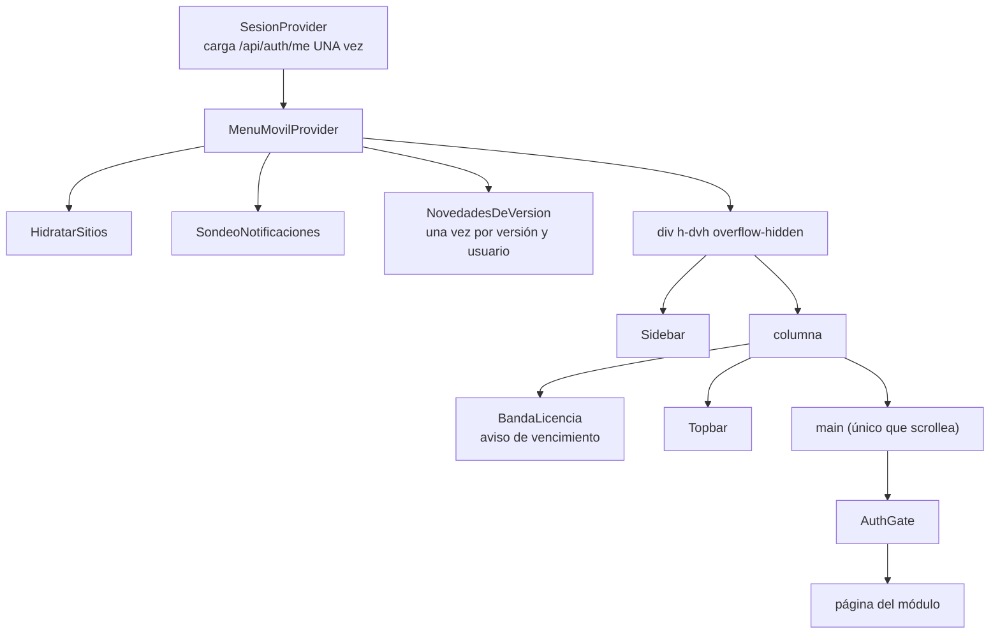

# Shell y navegación

## Composición

`app/(app)/(shell)/layout.tsx`:

> [!note] 2026-10-05 · dos piezas que el diagrama no tenía
> `NovedadesDeVersion` (`layout.tsx:92`) enseña las notas de la versión
> instalada **una vez por versión y usuario** —va en el shell porque todo
> usuario con sesión pasa por él— y `BandaLicencia` (`layout.tsx:99`) pinta el
> aviso de vencimiento de la licencia, leída en el servidor por
> `leerAvisoDeLicencia()` (`layout.tsx:43-71`). Un `ENOENT` calla (hijo
> administrado, el caso normal); **cualquier otro error se registra**, porque
> hasta el 11/09 un archivo ilegible callaba igual y la banda no salía nunca.

`h-dvh` y no `h-screen` a propósito: para que la barra de direcciones móvil no
recorte el pie del menú.

## Las tres capas de control de acceso

| Capa | Qué comprueba | Dónde | Se puede saltar |
|---|---|---|---|
| Middleware | Que **exista** la cookie `spaces_sesion` | `middleware.ts:176` | Sí (cookie falsa) |
| `AuthGate` | Sesión real + rol vs módulo de la ruta | `AuthGate.tsx` | Sí (es cliente) |
| `exigir()` en cada route handler | Sesión válida + permiso | `lib/server/auth.ts` | **No** |

> [!danger] Solo la tercera es seguridad
> Las dos primeras son experiencia de usuario. La autorización real vive en el
> servidor. Ver [[autenticacion-y-sesion]].

## `AuthGate` y el `NAV` compartido

`AuthGate.tsx:16-18` — el control de acceso por ruta usa **el mismo `NAV`** que
pinta el menú (`components/demo/shell/nav.ts`), así ocultar el ítem y bloquear la
ruta nunca se desincronizan. Eso cierra las fugas por enlaces directos, no solo
el menú. El emparejamiento está en `moduloDe()` (`AuthGate.tsx:20-28`): gana la
ruta más larga, y desde el 17/11 se emparejan **todas las rutas de cada
entrada** —la suya y las de `tambien`, con `rutasDe()`—, no solo su `href`.
Ver «Propuestas (y el CRM)» abajo: es lo que mantiene `/crm` y la ficha de oportunidad bajo compuerta. Las salidas obligatorias (códigos de recuperación, contraseña
temporal) se deciden aparte, sin React, en `compuerta.ts`.

Comportamiento:
- Sin sesión → `/login`
- Rol sin acceso al módulo de la ruta → su *landing* (`landingDeRol`)

> [!warning] `nav.ts` es archivo de alto contacto
> Añadir un módulo toca el menú **y** el control de acceso a la vez. Requiere
> claim exclusivo — ver [[AGENTES]].

### Los grupos del menú, y la trampa de buscarlos por su rótulo

El menú va por **fases del proceso**, declaradas en `GRUPOS` (`nav.ts:110-118`), y el
orden de ese arreglo **es** el orden en pantalla. Al 2026-10-05 (26 entradas):

| Clave (código) | Rótulo (pantalla) | Entradas |
|---|---|---|
| `inicio` | *sin título* | Dashboard |
| `patrimonio` | **Inventario** | **Prospección** · Inventario · **Vallas** («En proceso», 19/11) · Arrendadores · Network · Almacén |
| `ojos` | **Space Eyes** | Equipos · Comprobantes (PoD; antes «Galería», 17/11) · Gráficas · Ajustar texto · Programación · Campañas · Verificación · Fallas — desde v0.11.0 (08/10, ADR 0045); fuera de la cuenta de 26 de arriba. Ajustar texto y Programación solo MANDO; el resto MANDO + VENTA. `hrefActivo()` (`nav.ts:326-329`) enciende **una sola** entrada en sus subpáginas (v0.11.5) |
| `vender` | **Comercial** | Clientes · Comercial · Disponibilidad · **Vallas** (espejo, 19/11) · **Propuestas** (fue «CRM» del 17 al 18/11) · Franjas y temporadas · Descuentos por volumen · Códigos de negociación · Paquetes cerrados |
| `entregar` | **Operaciones** | Campañas · **Creativos** · Imprenta · Operaciones · Consumo de luz |
| `cobrar` | **Finanzas** | Finanzas · Reportes · Comisiones |
| `sistema` | **Sistema** | Integraciones · Razones sociales · Actividad · Administración |

> [!important] 2026-11-19 · **la misma pantalla en dos grupos: el ESPEJO** (Vallas)
> Pedido del dueño: «Vallas va igual en Comercial». Hasta hoy una ruta pertenecía a UNA
> entrada (`nav.test.ts`: claves y rutas únicas), porque `AuthGate` empareja por ruta y
> dos entradas con roles distintos harían que la puerta dependiera del orden del arreglo.
>
> El cambio genérico mínimo es **`NavItem.espejoDe`**: una entrada construida con
> `espejo(original, clave, grupo)` (`nav.ts`) que copia ruta, rótulo, icono, roles,
> `tambien` e insignia de la original y cambia solo clave y grupo. Así:
> - **Compuerta**: las dos entradas de `/vallas` tienen los MISMOS roles; da igual cuál
>   gane en `moduloDe()`. `nav.test.ts` lo exige para todo espejo (y que no sea espejo de
>   un espejo ni esté en el grupo de su original), y la unicidad de rutas se mide sobre las
>   entradas que no son espejo.
> - **Texto**: se traduce con la clave de la original (`claveDeTexto()`, `nav.vallas`); no
>   hay `nav.vallas-comercial` en el diccionario y `diccionario.test.ts` lo sabe.
> - **Resaltado**: en `/vallas` se encienden **las dos** (Inventario y Comercial). Es la
>   misma página; marcar solo la del grupo desde el que se entró pediría estado fuera de
>   la URL (o un `?desde=`) para no ganar nada. Con una sección plegada, la entrada actual
>   se queda a la vista bajo su título como siempre; colapsado, se ven los dos iconos
>   encendidos, cada uno en su tramo.
> - **Atajos del 404, matriz de Administración (`lib/modulos.ts`)**: sin cambios; Vallas
>   sigue siendo una sola área del módulo `inventario`.
>
> Los roles de Vallas pasan de `MANDO` a `MANDO` + `VENTA` (quien ve Comercial), y la ven
> en los dos grupos. Ningún permiso del servidor cambió: ver [[02-Backend/vallas]]. Lo
> vigila `components/demo/shell/vallas-en-comercial.test.ts`, que pinta el `Sidebar` real
> para cada rol.

> [!important] 2026-11-18 · **vuelve «Propuestas»**: lo de abajo duró un día
> Pedido del dueño: «en el CRM no se debe de llamar CRM sino Propuestas». La
> entrada vuelve a ser `{ key: 'propuestas', label: 'Propuestas', href:
> '/propuestas', tambien: ['/crm'], icon: FileText }` (`nav.ts:204`), con los
> mismos roles; `nav.crm` ya no es una entrada (queda como rótulo del área
> `crm` en la matriz de Administración: «Oportunidades»). El embudo, las
> oportunidades y los prospectos son pestañas de `/propuestas?vista=…`;
> `/crm` redirige allí, y `/crm/oportunidades/[id]` enciende «Propuestas» por
> `tambien`. El atajo del 404 vuelve a ser `propuestas`. Lo vigila
> `nav.test.ts` («ADR 0051 · «Propuestas» con las oportunidades dentro»).

> [!note] 2026-11-17 · **«CRM» sustituye a «Propuestas»** en el grupo Comercial (ADR 0051, Fase 4) — DESHECHO el 18/11 (arriba)
> La entrada `crm` (`components/demo/shell/nav.ts:202`) va en el lugar que
> tenía `propuestas`, con los **mismos roles** (`MANDO` + `VENTA`) y el icono
> `Target`. Lleva a `/crm` (Embudo · Oportunidades · Prospectos) y **Propuestas
> es su cuarta pestaña**: `/propuestas` y `/propuestas/[id]` **siguen vivas, con
> la misma dirección**, y encienden «CRM».
>
> Lo hace un campo nuevo de `NavItem`, **`tambien: ['/propuestas']`**, con
> `rutasDe()` (`nav.ts:94-105`), que cuenta en dos sitios:
> - el `Sidebar` enciende la entrada si la ruta es de cualquiera de sus rutas
>   (`Sidebar.tsx:93-94`);
> - **la compuerta de `AuthGate`** empareja con todas ellas (`AuthGate.tsx:20-28`).
>   Es lo que importa: sin `tambien`, `/propuestas` se habría quedado sin
>   entrada en `NAV` y por tanto **sin compuerta de roles**.
>
> `nav.test.ts:309-327` vigila que ninguna ruta sea de dos entradas (la
> compuerta no puede dudar qué roles aplicar). Y la prueba de orden «Propuestas
> antes que Campañas» **pasaba en falso** al quitar la entrada: `findIndex` daba
> -1, menor que cualquier posición. Ahora mira `crm` y exige que exista
> (`nav.test.ts:41-50`). El atajo del 404 también cambió de clave
> (`lib/atajos-404.ts:43`). Detalle en [[crm-oportunidades]].

> [!note] 2026-11-17 · Prospección es la **primera** entrada de Inventario
> Pedido del dueño: «poner hasta arriba de la sección de inventario». Antes iba
> debajo de Arrendadores (lo que cuenta la nota del 16/11 de abajo); ahora va
> antes que Inventario. Solo cambia el orden en `NAV`: la clave, la ruta, los
> roles y el módulo siguen igual. Lo fija `nav.test.ts` (primera del grupo
> `patrimonio` y seguida de `inventario`).

> [!note] 2026-11-16 · «Comercial negociación» es **Prospección** y vive en Inventario
> Pedido del dueño: se renombra y sube al grupo `patrimonio`, justo debajo de
> Arrendadores (`nav.ts`, entrada `comercial-opex`). En inglés *Prospecting*, en
> italiano *Prospezione*, en portugués *Prospecção*; cambia también el título de
> la página y el rótulo de `lib/modulos.ts` (la pantalla de permisos). **No
> cambian** la clave `comercial-opex`, la ruta `/comercial-opex`, los roles
> (MANDO + VENTA) ni el módulo de permisos (`captacion`). Un vendedor ya veía el
> encabezado Inventario por Network, así que no le aparece un grupo nuevo.

> [!note] 2026-10-13 · dos rótulos cambiados por el dueño
> «Comercial OPEX» se llama **Comercial negociación** y «Códigos promocionales»
> **Códigos de negociación** (en el menú, en `lib/modulos.ts` —la pantalla de
> permisos— y en el título de cada página; en la propuesta y en Paquetes,
> «código promocional» pasa a «código de negociación»). **Solo cambian los
> rótulos**: las claves (`comercial-opex`, `codigos-promocionales`), las rutas
> y los permisos siguen igual, así que ningún rol pierde ni gana acceso. Los
> mensajes de error del servidor siguen diciendo «codigo promocional».
>
> [!note] 2026-10-05 · el grupo Comercial tenía cinco entradas sin listar
> La tabla se había quedado en cuatro. Desde el 29-30/09 cuelgan de `vender`
> **Comercial OPEX** (`nav.ts:188`, la maqueta de prospección de arrendadores,
> ver [[comercial-opex]]) y las cuatro de la **cadena de precio del ADR 0039**,
> en el orden de la cadena: Franjas y temporadas (`:201`), Descuentos por
> volumen (`:220`), Códigos promocionales (`:226`) y Paquetes cerrados (`:233`).
> Esas cuatro las ven solo `MANDO` y `JEFES_VENTA` (`nav.ts:125-127`, ADR 0040):
> el VENDEDOR aplica códigos y paquetes pero no los crea. Su permiso sigue siendo
> el módulo `inventario`, el de sus endpoints — el permiso dice quién puede
> tocarlas, no de quién es el trabajo.
>
> **Captación** está **fuera del menú** desde el 30/09 (`nav.ts:179-184`, la
> línea queda comentada): se solapaba con Comercial OPEX. Solo se quitó la
> entrada; tablas, API y módulo `captacion` siguen.

> [!important] 2026-09-30 · Creativos VOLVIÓ a **Operaciones**
> Pedido literal del dueño: «el menu de creativo muevelo a operaciones». Cuelga
> de `entregar`, **justo después de Campañas**: sus pautas se arman sobre una
> campaña ya creada, y desde el mismo día la pantalla solo lista campañas de
> pantallas digitales (`lib/creativos-digitales.ts`).
>
> **Se movió el grupo, NO los roles**: sigue siendo `[...MANDO, ...VENTA]`,
> porque `lib/modulos.ts` la autoriza con el módulo `comercial`. Un rol
> OPERACIONES sigue sin verla — darle la entrada sin el permiso sería ofrecerle
> una pantalla que responde 403. Quien vende la encuentra bajo «Operaciones»,
> donde ya ve Campañas. Lo fija `nav.test.ts` §3 bis.
>
> El recuadro de abajo es la historia del primer movimiento (28/09) y se
> conserva por su porqué, no porque siga vigente.

> [!important] Creativos se movió a **Comercial** el 2026-09-28
> Estaba en `entregar` y ahora cuelga de `vender`, justo después de Propuestas.
> Lo pidió un dueño con una pregunta literal —«¿puedo programar las pautas desde
> el módulo de ventas?»— y la respuesta era **no**: la pantalla existía,
> funcionaba y la abrían DUEÑO y COMERCIAL, pero colgaba de un encabezado de
> otra área y **no la enlazaba ni Propuestas ni Comercial**. Solo se llegaba
> desde la ficha de una campaña (`campanas/[id]/page.tsx:395-401`, que sigue;
> al 2026-10-05 el enlace «Gestionar» está en `:422-427`).
>
> **Se movió en vez de duplicarse, y duplicar no era una opción cara: era
> imposible.** `nav.test.ts` exige claves **y rutas** únicas, y `AuthGate`
> empareja por `href` (`path === n.href || path.startsWith(n.href + '/')`), así
> que dos entradas con la misma ruta se encenderían las dos a la vez.
>
> Encaja además con quién la autoriza: `lib/modulos.ts:36` la pone bajo el módulo
> **`comercial`**, no `operaciones` — un rol OPERACIONES nunca la vio.
>
> **Lo que cuesta, dicho:** el tramo «Operaciones» pierde el paso donde se sube
> el arte, y el relato del menú —vender primero, entregar después— se estira,
> porque una pauta se arma sobre algo ya vendido. Se aceptó a propósito.
> Fijado por `nav.test.ts` §«3 bis».

> [!warning] La clave NO es el rótulo, y buscar por el rótulo no encuentra nada
> `vender` se pinta **Comercial** y `entregar` se pinta **Operaciones**. Las
> claves se dejan como están a propósito: renombrarlas obligaría a tocar las
> dieciocho entradas para no cambiar nada de lo que se ve. Si buscas el grupo
> «Comercial» en el código, `grep 'Comercial'` te da la ENTRADA, no el grupo.
>
> Los rótulos han cambiado tres veces —`Vender` → `Ventas` (26/08) →
> `Comercial` (08/09), y `Entregar` → `Operaciones` (08/09)—, y las claves
> ninguna. Eso es la señal de que la separación funciona.

**Cuatro grupos se llaman igual que una de sus entradas** (Inventario, Comercial,
Operaciones y Finanzas). Es deliberado: el encabezado nombra la fase, la entrada
es la pantalla principal de esa fase. Un grupo sin ítems visibles no pinta su
título, así que un rol de Operaciones ve dos entradas y no seis encabezados
vacíos.

`nav.test.ts` protege la **estructura**, no los rótulos: que las entradas de un
grupo vayan seguidas, que ningún grupo declarado quede vacío, que el orden en
pantalla sea el de `GRUPOS`, y que Propuestas vaya antes que Campañas y Campañas
antes que Finanzas. Cambiar un rótulo no pone roja ninguna prueba — es un dato
que solo se ve mirando.

### El menú en cascada (MENU-CASCADA, 12/11)

Pedido del dueño: «que cada sección esté desplegada, pero si se desea ocultar el
resto y solo dejar el nombre del submenú, guardándolo en localStorage».

- El título de cada sección del `Sidebar` es un botón (`aria-expanded`) con
  una flecha: pliega la sección a su nombre. Dashboard no tiene título y no se
  pliega.
- Se guarda lo **plegado** en `localStorage` (`spaces:menu-plegado`,
  `lib/menu-plegado.ts`). Sin nada guardado todo va desplegado, como antes, y
  una sección nueva aparece abierta.
- Una sección plegada que contiene la pantalla actual pinta su título en azul
  **y deja esa entrada a la vista** bajo el título, para no perder dónde estás.
- Plegada, el título dice **cuántas opciones** guarda (la insignia gris).
- Abrir y cerrar **se anima** (`grid-template-rows: 0fr → 1fr`, sin medir
  nada; `motion-reduce` lo apaga). No se anima al cargar: quien tenía secciones
  plegadas las vería cerrarse solas en cada página.
- Plegados, los enlaces salen del tabulador (`tabIndex=-1` y `aria-hidden`).
- **Pie del menú**: un botón pliega todas las secciones o, si ya lo están, las
  despliega (`alternarTodas`).
- Con el menú en modo icono no hay títulos que pulsar: se ven todos los iconos.
- `bg-transparent` en el botón: sin él el navegador le pone su gris (visto
  en el navegador el 12/11).

> [!warning] Dos trampas que se vieron en el navegador el 12/11
> - **El menú se pinta dos veces** (barra de escritorio y cajón del móvil), cada
>   copia con su estado. Plegar en una no se veía en la otra hasta recargar. Ahora
>   `guardar()` avisa con el evento `spaces:menu-plegado-cambio` y la otra copia
>   adopta el conjunto. `storage` no sirve: no salta en la pestaña que escribe.
>   Y el aviso sale FUERA del `setState`: dentro, React protestaría por actualizar
>   un componente mientras pinta otro.
> - **La rejilla animada va en el `<li>`**, no en un `
` dentro: como
>   `list-item`, el `<li>` conservaba su caja de línea y cada sección plegada
>   dejaba 15 px de hueco (medido: rejilla 0 px, `<li>` 15,2 px).

## Sesión compartida

`SesionContext.tsx` carga `/api/auth/me` **una sola vez** y la comparte con
Sidebar, Topbar, AuthGate y las pantallas. `sesion === undefined` significa
*cargando*; `null` significa *sin sesión*. Confundirlos produce un parpadeo al
login.

## Middleware

`apps/web/middleware.ts`, matcher casi total. Hace cuatro cosas en orden:

1. **308 legado** (`:103-109`): `/demo` → `/inicio`, `/demo/*` → `/*`
2. **CSRF double-submit** (`:117-145`) en mutaciones `/api/` con sesión
3. **Ruteo por subdominio** (`:150-159`): solo `portal` → `/portal`, y solo fuera de dev
4. **Gate de sesión** (`:164-177`): sin cookie → `/login`

Las dos redirecciones (1 y 4) salen por `redirigir()` (`:78-87`), que arma una
`Location` **absoluta** con el origen tomado del `Host` vía `origenPublico()`
(ADR 0033): el 09/09 el redirect mandaba a `localhost`, y el 17/09 una
`Location` relativa daba 500 en Next 14.2.29. El porqué completo está en el
comentario de `middleware.ts:15-77`.

Rutas públicas del gate: `/api/*`, `/_next/*`, `/favicon*`, `/login`,
`/recuperar/*`, `/p/*`, `/firmar/*`, `/portal/*`.

### Quién mira el `Host`

`apps/web/lib/host.ts` — `etiquetaDeHost(host)`, función **pura** y con pruebas
(`host.test.ts`). Lo único que decide es si el rewrite del punto 3 se dispara. **No** resuelve marcas
ni organizaciones, y el host **no entra en la cadena de datos**: el modelo de
subdominios por tenant está descartado ([[modelo-instancias-soberanas]]).

> [!note] 2026-10-05 · ya no es la ÚNICA que lee el `Host`
> Esta nota decía que `etiquetaDeHost` era la única del sistema que leía el
> encabezado. Desde el 17/09 hay una segunda en el mismo archivo:
> `origenPublico()` (`lib/host.ts:84`), que da el **origen** de las
> redirecciones del middleware (`middleware.ts:81`). Decide de qué dominio sale
> la `Location`, **nunca a dónde va el usuario**: el destino es siempre una ruta
> interna fija.

> [!warning] Una IP no es un subdominio (corregido el 13/08)
> La versión anterior contaba puntos (`parts.length >= 3`), así que entrar por la
> IP desnuda del droplet —`209.97.146.136`— daba la etiqueta `'209'` y reescribía
> la ruta. No rompía nada solo porque `209` no está en el `moduleMap`. Ahora se
> descartan IPv4/IPv6 literales, los primeros segmentos numéricos y los hosts sin
> tres etiquetas; `demo.space-os.io` sigue devolviendo `'demo'`, igual que antes.

> [!note] `BASE_PATH` está duplicado
> `middleware.ts:6` define `'/spaces-dooh'` con un comentario que dice *"Must
> match basePath in next.config.mjs"*. Son dos sitios que hay que cambiar a la
> vez.

## Notificaciones en vivo

`SondeoNotificaciones` sondea `/api/notificaciones/nuevas`. Vive **solo dentro
del shell**: sin sesión no hay a quién avisar y el sondeo pediría por nada.

## Relacionadas
[[03-Frontend/_indice|Índice de Frontend]] · [[estado-y-data-fetching]] ·
[[modulos-internos]] · [[autenticacion-y-sesion]] · [[MOC-Proyecto]]
